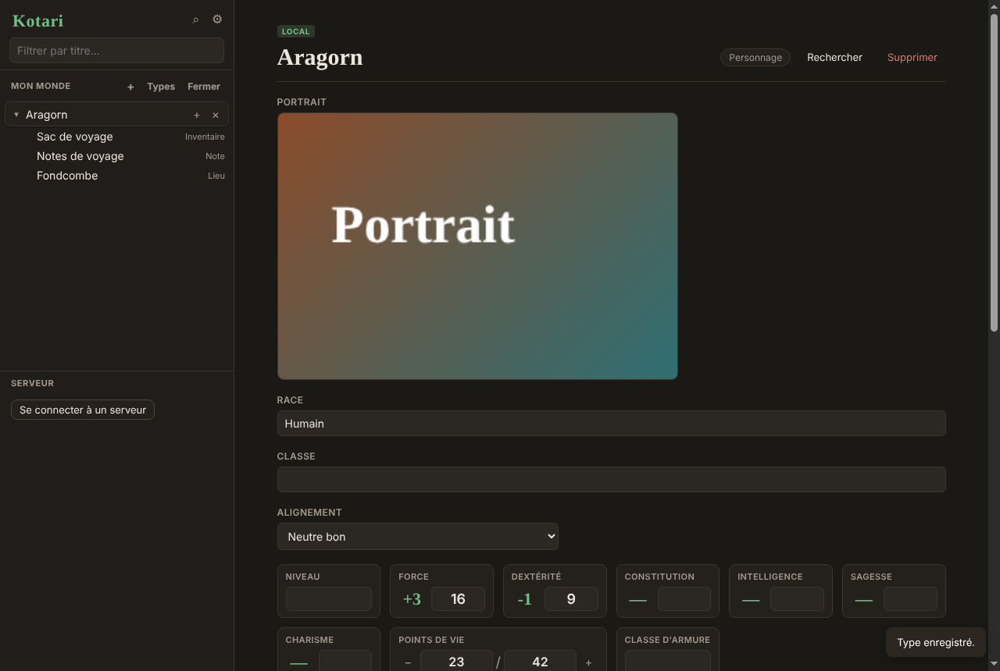
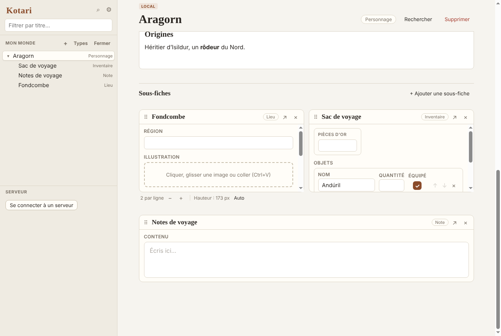
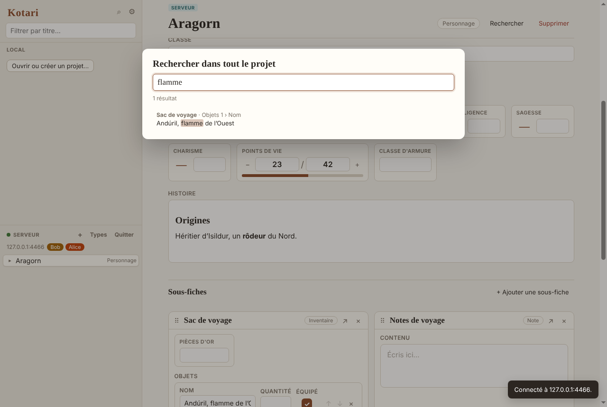
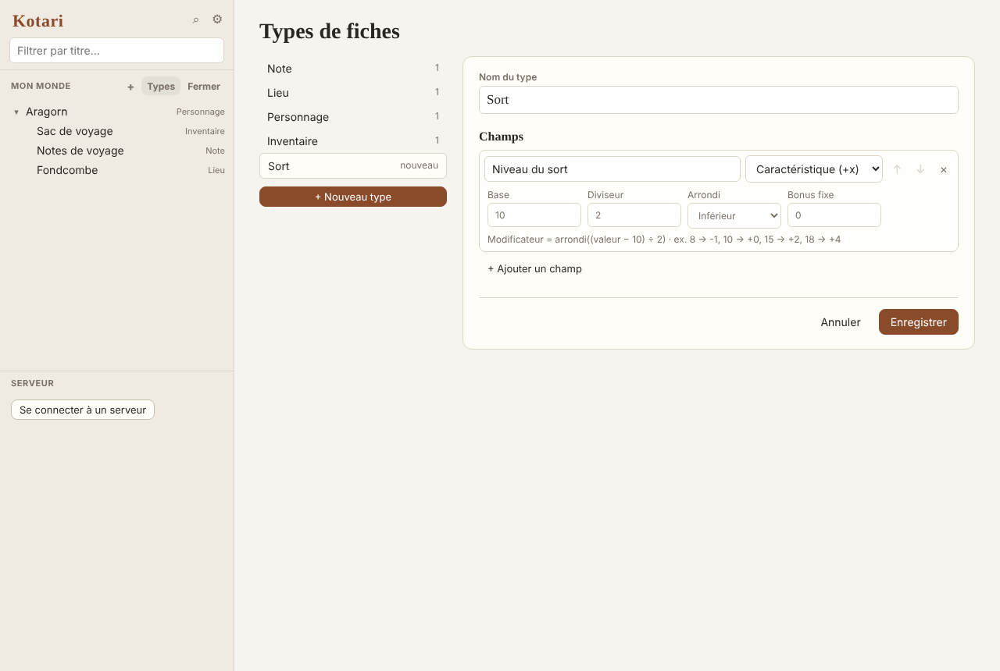

<div align="center">

# Kotari

**Des fiches imbriquées pour tes mondes, tes personnages et leurs inventaires —
en local, ou à plusieurs en temps réel.**

[**⬇ Télécharger pour Windows**](https://github.com/Zomboglace/Kotari/releases/latest/download/Kotari-Setup.exe)
· [Toutes les versions](https://github.com/Zomboglace/Kotari/releases)
· [Installer un serveur](#3-jouer-à-plusieurs--installer-un-serveur)



</div>

## Présentation

Kotari est un éditeur de fiches pour le jeu de rôle, l'écriture ou la création de
mondes. Chaque fiche a un **type** (Personnage, Lieu, Inventaire… ou les tiens) qui
définit ses champs, et chaque fiche peut contenir des **sous-fiches** : un Inventaire
sous un Personnage, des Lieux sous une Région, des Notes sous une Quête.

- **Tes types de fiches, tes champs** : texte, nombre, texte riche, caractéristique
  avec modificateur (+3 pour 16, formule réglable), jauge actuel / max, case à cocher,
  choix dans une liste, image, et listes (qui peuvent contenir des listes).
- **Modèles prêts à l'emploi** : Note, Lieu, Personnage façon D&D 5e, Inventaire.
- **Sous-fiches affichées dans la fiche parente**, en cartes modifiables sur place,
  rangées en lignes dont on règle le nombre de cartes et la hauteur.
- **Texte riche épuré** : pas de barre d'outils, la mise en forme se tape façon
  Markdown (`## titre`, `**gras**`, `- liste`, `> citation`).
- **Recherche** dans la fiche (`Ctrl+F`) ou dans tout le projet (`Ctrl+Maj+F`).
- **Thème clair ou sombre**, couleur d'accent au choix.
- **À plusieurs en temps réel** : connecte-toi à un serveur Kotari, éditez les
  mêmes fiches en même temps (comme Google Docs), avec le curseur de chacun.
  Tes fiches locales restent sur ton PC ; glisse une fiche vers le serveur pour la
  partager (copie, sous-fiches comprises).
- **Tout est enregistré automatiquement**, dans de simples fichiers : un projet est
  un dossier que tu peux copier ou sauvegarder.
- **Mises à jour automatiques** depuis GitHub.

| Sous-fiches en cartes | Recherche dans tout le projet | Types de fiches |
| :---: | :---: | :---: |
|  |  |  |

---

## 1. Installer Kotari (Windows)

1. Télécharge [**Kotari-Setup.exe**](https://github.com/Zomboglace/Kotari/releases/latest/download/Kotari-Setup.exe).
2. Lance-le. L'installateur n'est pas signé : si Windows affiche « Windows a protégé
   votre ordinateur », clique sur **Informations complémentaires → Exécuter quand même**.
3. Ouvre Kotari, crée un projet (choisis un dossier) en gardant les modèles cochés,
   puis **+ Nouvelle fiche**.

Les mises à jour se font toutes seules : quand une nouvelle version est prête, un bouton
**Redémarrer** apparaît en bas de la barre latérale. Réglages et raccourcis : ⚙ en haut
à gauche.

## 2. Utilisation rapide

| Action | Comment |
| --- | --- |
| Créer une sous-fiche | `+` sur une fiche de l'arbre, ou « Ajouter une sous-fiche » |
| Déplacer une fiche | Glisser dans l'arbre (milieu = sous-fiche, bord = avant / après) |
| Partager une fiche | La glisser de l'arbre local vers l'arbre serveur (copie) |
| Ranger les sous-fiches | Glisser une carte par sa poignée ⠿ ; `−` / `+` et la barre sous la ligne |
| Créer ou modifier un type | Bouton **Types** au-dessus de l'arbre |
| Rechercher | `Ctrl+F` (fiche) · `Ctrl+Maj+F` (tout) |

## 3. Jouer à plusieurs : installer un serveur

Le serveur (**kotari-server**) est un petit programme Node.js sans interface qui
héberge un projet partagé. Trois façons de l'utiliser :

| Situation | Solution |
| --- | --- |
| Un serveur sur Internet (VPS : Hetzner, OVH, Scaleway…) avec un nom de domaine | [3.1 Script automatique](#31-sur-un-vps-avec-un-nom-de-domaine-recommandé) |
| Tout le monde est chez toi, sur la même box | [3.2 Réseau local](#32-sur-le-réseau-local) |
| Un serveur chez toi, des joueurs ailleurs, sans nom de domaine | [3.3 Tailscale](#33-sans-nom-de-domaine--tailscale) |

### 3.1 Sur un VPS, avec un nom de domaine (recommandé)

Prérequis : un serveur **Ubuntu 22.04+ ou Debian 12+** auquel tu accèdes en SSH, et un
nom de domaine.

1. **DNS** : chez le fournisseur du domaine, crée un enregistrement **A** qui pointe un
   sous-domaine (par ex. `kotari`) vers l'adresse IP du serveur.
2. **Installation**, connecté en SSH au serveur :

   ```bash
   curl -fsSL https://raw.githubusercontent.com/Zomboglace/Kotari/main/deploy/install-serveur.sh -o install-serveur.sh
   sudo bash install-serveur.sh kotari.mondomaine.fr
   ```

   Le script demande le nom du projet partagé et le **mot de passe** que les joueurs
   saisiront. Il installe Node.js 22, kotari-server, [Caddy](https://caddyserver.com)
   (HTTPS avec certificat automatique), le démarrage automatique et le pare-feu
   (SSH, HTTP et HTTPS uniquement).
3. **Dans Kotari** : « Se connecter à un serveur », adresse `kotari.mondomaine.fr`
   (port 443 et « Connexion sécurisée » se remplissent seuls), le mot de passe, ton prénom.

Si ton hébergeur a un pare-feu dans sa console (Hetzner « Firewalls », etc.), autorise
aussi les ports 80 et 443.

**Sur le serveur, ensuite :**

```bash
sudo bash install-serveur.sh kotari.mondomaine.fr     # mettre à jour (données conservées)
journalctl -u kotari-server -f                         # voir les connexions
sudo systemctl restart kotari-server                   # redémarrer
sudo -u kotari node /opt/kotari-server/kotari-server.mjs password /var/lib/kotari/projet   # changer le mot de passe
```

Les données sont dans `/var/lib/kotari/projet` : copie ce dossier pour les sauvegarder.

### 3.2 Sur le réseau local

Sur un PC ou un Raspberry Pi toujours allumé, avec [Node.js 22+](https://nodejs.org) :

1. Télécharge [**kotari-server.zip**](https://github.com/Zomboglace/Kotari/releases/latest/download/kotari-server.zip)
   et décompresse-le.
2. Sous Windows, double-clique sur `demarrer.cmd` (il prépare le projet la première
   fois). Ailleurs :

   ```bash
   node kotari-server.mjs init ./table-partagee    # une fois : port et mot de passe
   node kotari-server.mjs start ./table-partagee
   ```

3. Dans Kotari, saisis l'adresse affichée par le serveur (par ex. `192.168.1.20`) et
   le port (4321 par défaut).

Le `LISEZMOI.md` du zip explique aussi le démarrage automatique (systemd). Sans HTTPS
la connexion n'est pas chiffrée : **n'ouvre pas ce port sur ta box**.

### 3.3 Sans nom de domaine : Tailscale

Installe [Tailscale](https://tailscale.com) (gratuit) sur la machine serveur et sur
chaque PC, puis suis la méthode 3.2 en utilisant l'adresse Tailscale du serveur
(`100.x.y.z`). Tailscale chiffre la liaison ; aucun port n'est ouvert sur Internet.

---

## Développement

Prérequis : Node.js 22+. Electron + React + TypeScript (electron-vite), Yjs + TipTap
pour l'édition collaborative, Hocuspocus pour le serveur.

```bash
npm install
npm run dev            # lance l'app avec rechargement à chaud
npm test               # tests (serveur réel + deux clients)
npm run typecheck
npm run dist           # installateur Windows local dans release/ (sans publier)
npm run build:server   # dist-server/kotari-server/
```

### Publier une version

1. Change `version` dans `package.json` (ex. `0.3.2`) et committe.
2. `git tag v0.3.2 && git push && git push origin v0.3.2`
3. GitHub Actions (`.github/workflows/release.yml`) construit et publie la release :
   `Kotari-Setup.exe`, `latest.yml` (mises à jour automatiques), `kotari-server.zip`,
   `install-serveur.sh`. Les Kotari installés la trouvent au prochain démarrage.

### Organisation du code

```text
src/shared/     format de projet, champs, contenu Yjs, recherche, copie, protocole
src/main/       process principal Electron (seul à toucher le disque, mises à jour)
src/preload/    API minimale exposée à l'interface
src/renderer/   interface React (arbres, fiche, cartes, types, recherche, réglages)
src/server/     kotari-server (Hocuspocus)
deploy/         script d'installation sur VPS
tests/          tests d'intégration
```

### Format d'un projet

```text
mon-monde/
  kotari.json              nom, version du format
  types/<id>.json          définition des champs
  documents/<id>.json      titre, type, parent, ordre
  documents/<id>.yjs       contenu (Yjs : fusion des saisies simultanées)
  images/<empreinte>       images (SHA-256, jamais en double)
  server.json              côté serveur uniquement : port, mot de passe haché (ne pas publier)
```

Le même dossier s'ouvre en local ou s'héberge sur un serveur.

### Sécurité

- L'interface n'a accès ni à Node ni au disque (`contextIsolation`, preload minimal) ;
  le serveur n'écrit que dans le dossier hébergé.
- Mot de passe du serveur stocké haché (scrypt), essais ralentis en cas d'erreur.
  Côté client, il n'est retenu que si on coche la case, chiffré avec le compte Windows.
- Sur Internet, toujours passer par HTTPS (Caddy) ou un tunnel (Tailscale).

## Licence

[MIT](LICENSE) © 2026 Nicolas
